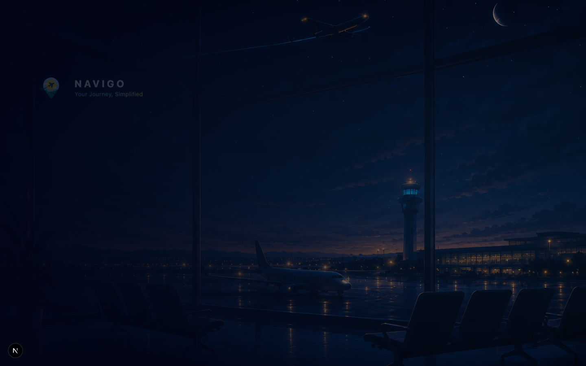
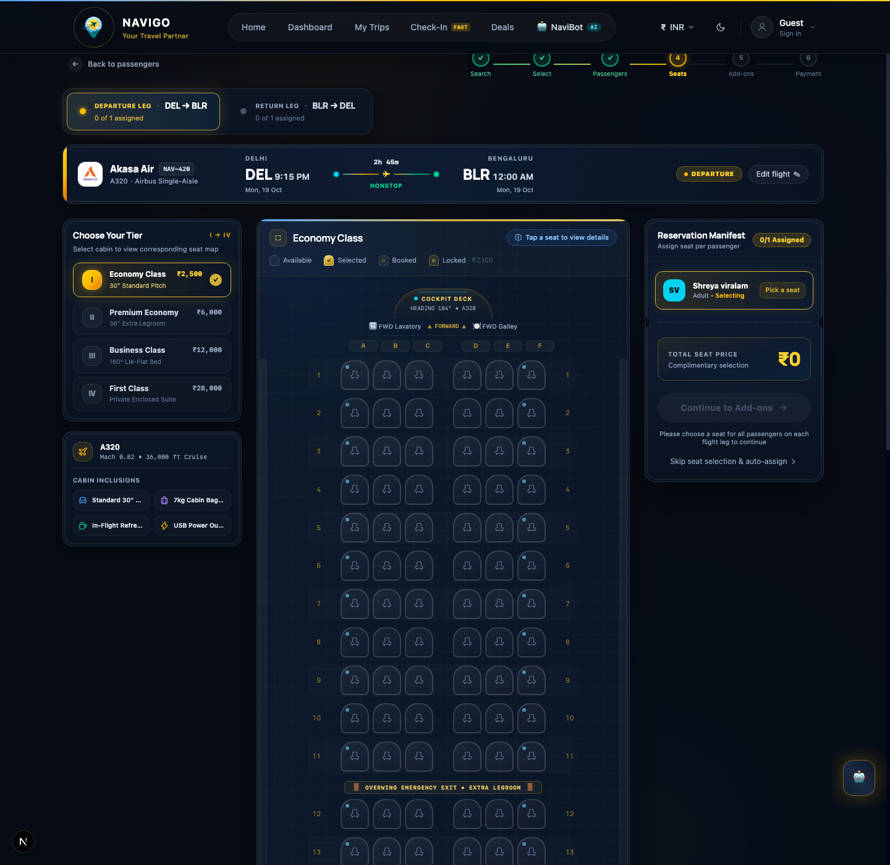
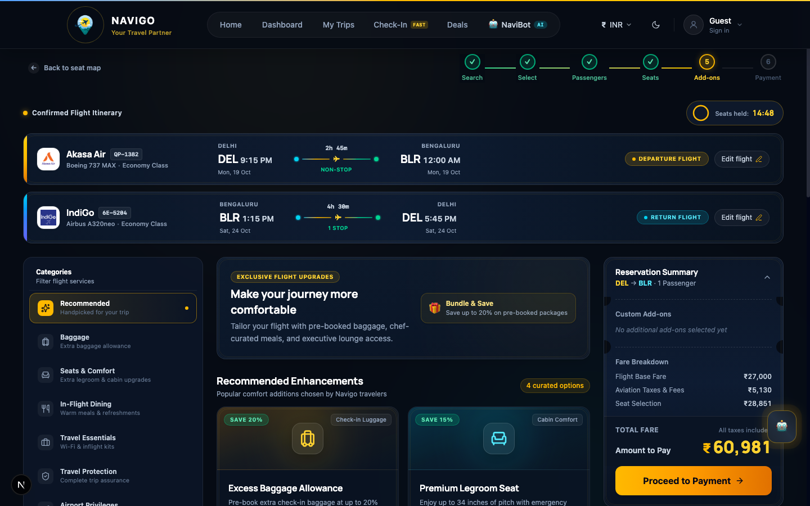
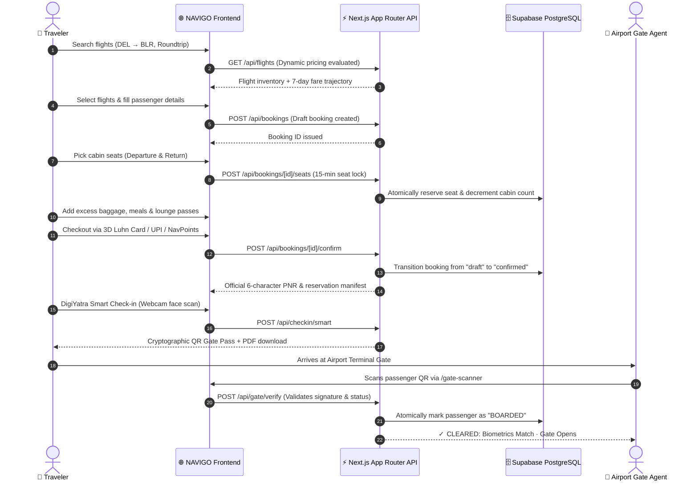

<div align="center">

  

  # NAVIGO ✈️
  ### *Next-Generation Airline Booking, Smart Airport Operations & Biometric Travel Platform*

  <p align="center">
    <b>A luxury aerospace digital experience blending high-converting passenger booking flows, cinematic 3D aircraft fuselage seat selection, DigiYatra-style facial biometrics, and enterprise airline operational dispatching.</b>
  </p>

  [](https://github.com/Dhruv-vm/Navigo-airline_Platform)
  [](https://nextjs.org/)
  [](https://react.dev/)
  [](https://www.typescriptlang.org/)
  [](https://tailwindcss.com/)
  [](https://supabase.com/)
  [](https://www.framer.com/motion/)

  <br />

  [Explore Product Tour](#-visual-interface--output-showcase) •
  [Passenger & Airport Workflow](#-end-to-end-traveler--airport-workflow) •
  [System Architecture](#-system-architecture) •
  [Quickstart Guide](#-getting-started) •
  [API Reference](#-api-endpoints) •
  [Design System](#-design-system--aerospace-palette)

</div>

---

## 🌟 Executive Summary

**NAVIGO** is a modern full-stack commercial airline reservation and airport operations platform. Designed with a **Dark Aerospace Luxury** visual language, NAVIGO merges commercial consumer booking flows with real-world airport terminal ground operations:

- **6-Step Frictionless Traveler Funnel**: Dynamic flight search, fare trajectory calendars, traveler manifest entry, multi-cabin 3D seating, add-on marketplace, and sandboxed checkout.
- **Cinematic Aircraft Fuselage Seat Map**: Interactive cabin view across **First Class Pods**, **Business Class Flatbeds**, **Premium Economy**, and **Standard Economy** featuring cockpit horizons, emergency exit doors, and Framer Motion spring-physics rolling price odometers (`₹XX,XXX`).
- **Contactless DigiYatra Biometrics**: Web-based facial biometric registration, cryptographic digital boarding pass generation, and live airport gate scanner (`/gate-scanner`) with real-time boarding manifest verification.
- **Dynamic Pricing & Yield Management**: Real-time algorithmic pricing engine responding to advance booking windows, route load factors, and seat scarcity.
- **Mission Control Admin Suite (`/admin`)**: Complete airline operations dashboard overseeing live flight instances, gate assignments, manual seat overrides, passenger registries, and security audit logs.

---

## 📸 Visual Interface & Output Showcase

Experience NAVIGO’s premier digital interface from flight discovery to gate boarding clearance:

### 1. Hero Flight Discovery & Intelligent Search
> Intuitive origin and destination search with IATA airport autocomplete, flexible departure/return dates, passenger count selectors, and direct travel class filters.

<div align="center">
  
</div>

<br />

### 2. Live Flight Telemetry & Fare Matrix
> High-clarity flight schedules with real-time airline livery badges (Air India, IndiGo, Emirates, Vistara, Akasa Air, Qatar Airways), duration vectors, 7-day lowest price calendars, and dynamic pricing badges.

<div align="center">
  
</div>

<br />

### 3. Traveler Manifest & Contact Profiling
> Clean passenger registry forms with frequent flyer linkage, primary contact capture, and a saved passenger address book for one-click re-use.

<div align="center">
  
</div>

<br />

### 4. 3D Fuselage Cabin Seat Map & Mechanical Odometer
> True-to-scale aircraft fuselage featuring cockpit horizon lines, emergency exit row spacing, cabin tier pods, a 15-minute countdown hold timer, and Framer Motion mechanical rolling price counters.

<div align="center">
  
</div>

<br />

### 5. Curated Add-ons & In-Flight Services Marketplace
> Modular marketplace for excess baggage tiers (10kg / 15kg / 20kg), chef-crafted hot meals, airport executive lounge passes, travel insurance, and in-flight satellite Wi-Fi passes.

<div align="center">
  
</div>

<br />

### 6. Dynamic 3D Card Terminal & NavPoints Loyalty
> Sandboxed payment gateway with an interactive 3D card that detects brand (Visa, Mastercard, Amex, RuPay) and flips dynamically for CVV, paired with UPI QR simulation and a 2:1 NavPoints loyalty discount slider.

<div align="center">
  
</div>

---

## 🔄 End-to-End Traveler & Airport Workflow

```
┌─────────────────┐       ┌─────────────────────┐       ┌──────────────────────┐
│  01. DISCOVER   │ ────► │ 02. PASSENGER DATA  │ ────► │ 03. 3D CABIN SEATS   │
│ Flight search & │       │ Manifest records &  │       │ Fuselage map & 15-min│
│ dynamic pricing │       │ saved traveler book │       │ seat hold lock       │
└─────────────────┘       └─────────────────────┘       └──────────────────────┘
                                                                   │
                                                                   ▼
┌─────────────────┐       ┌─────────────────────┐       ┌──────────────────────┐
│  06. AIRPORT    │ ◄──── │ 05. CONFIRMATION    │ ◄──── │ 04. ANCILLARIES      │
│ DigiYatra face  │       │ Instant PNR, secure │       │ Meals, baggage tiers,│
│ gate clearance  │       │ QR & PDF pass       │       │ lounge passes & Wi-Fi│
└─────────────────┘       └─────────────────────┘       └──────────────────────┘
```

### Detailed Sequence Flowchart



---

## 📐 System Architecture

```mermaid
flowchart TD
    subgraph Client ["Client Presentation Layer (Next.js 16 + React 19)"]
        Landing["Landing & Discovery\n(/, /flights)"]
        BookingFlow["6-Step Checkout Funnel\n(/checkout/*)"]
        SmartCheckIn["DigiYatra Check-In & Gate\n(/check-in, /gate-scanner)"]
        PassengerDashboard["Passenger Hub\n(/dashboard, /my-trips)"]
        AdminSuite["Airline Mission Control\n(/admin/*)"]
        NaviBotWidget["NaviBot AI Concierge\n(Floating Widget)"]
    end

    subgraph StateEngines ["Reactive Engines & Canvas"]
        FramerPhysics["Framer Motion Engine\n(Rolling Digits & 3D Card)"]
        LoyaltyEngine["NavPoints Rewards\n(2 pts = ₹1 discount)"]
        PDFEngine["E-Ticket Generator\n(jspdf + html2canvas-pro)"]
    end

    subgraph Backend ["Sanitized App Router APIs (/api/*)"]
        AuthService["/api/auth/*\n(Secure Session JWT & BCrypt)"]
        FlightService["/api/flights/*\n(Dynamic Pricing & Cabin Layouts)"]
        BookingService["/api/bookings/*\n(Seat Locks, Holds & Confirmation)"]
        BiometricService["/api/biometrics/*\n(DigiYatra Hashing & Verification)"]
        GateService["/api/gate/verify\n(HMAC Boarding Clearance)"]
        AdminService["/api/admin/*\n(Fleet Ops, Overrides & Audit Trail)"]
    end

    subgraph Database ["Supabase PostgreSQL (Hardened RLS)"]
        UsersTable[("users")]
        FlightsTable[("flights & flight_instances")]
        BookingsTable[("bookings & booking_passengers")]
        SeatsTable[("booking_seats & cabin_inventory")]
        BiometricsTable[("user_biometric_profiles")]
        CheckinsTable[("smart_checkins")]
        AuditTable[("admin_audit_logs")]
    end

    Client --> StateEngines
    StateEngines --> Backend
    Backend --> Database
```



---

## 📂 Project Structure

```
navigo/
├── app/
│   ├── page.tsx                      # Luxury landing page & interactive flight search
│   ├── layout.tsx                    # Root layout with typography, theme & NaviBot
│   ├── globals.css                   # Tailwind CSS v4 design system & aerospace styles
│   ├── flights/page.tsx              # Flight search results, filters & 7-day fare insight
│   ├── checkout/
│   │   ├── passengers/page.tsx       # Traveler manifest details & saved address book
│   │   ├── seats/page.tsx            # 3D aircraft fuselage seat map & rolling counter
│   │   ├── addons/page.tsx           # Baggage tiers, hot meals & VIP lounge marketplace
│   │   └── payment/
│   │       ├── page.tsx              # Sandboxed 3D card, UPI & NavPoints checkout
│   │       ├── PaymentCard.tsx       # Interactive 3D flipping card with CVV detection
│   │       ├── BoardingPassDeck.tsx  # Boarding pass deck & ticket stubs
│   │       └── cardUtils.ts          # Luhn checksum validator & brand identifier
│   ├── check-in/page.tsx             # PNR retrieval & DigiYatra smart check-in
│   ├── gate/page.tsx                 # Airport terminal gate display
│   ├── gate-scanner/page.tsx         # Live camera/input gate boarding pass scanner
│   ├── dashboard/page.tsx            # Passenger flight countdown, telemetry & status
│   ├── my-trips/page.tsx             # Booking history & digital PDF boarding pass
│   ├── navibot/page.tsx              # Full-screen conversational AI flight concierge
│   ├── admin/
│   │   ├── page.tsx                  # Executive overview & revenue metrics
│   │   ├── flights/                  # Route & flight instance scheduling
│   │   ├── pricing/                  # Dynamic pricing rules & occupancy thresholds
│   │   ├── seats/                    # Real-time cabin seat inventory controller
│   │   ├── gates/                    # Terminal gate manager & status broadcaster
│   │   ├── bookings/                 # Live booking manifests & cancellations
│   │   ├── passengers/               # Passenger records & biometric IDs
│   │   └── audit-logs/               # Tamper-evident operational audit trail
│   └── api/                          # Sanitized Next.js App Router endpoints
├── components/
│   ├── navbar.tsx                    # Global glassmorphic navigation header
│   ├── searchbox.tsx                 # Real-time flight search & airport autocomplete
│   ├── rolling-price-counter.tsx     # Spring-physics mechanical rolling digit odometer
│   ├── FlightCard.tsx                # Serene boarding pass flight result card
│   ├── PriceInsight.tsx              # 7-day lowest fare trajectory calendar
│   ├── NaviBot.tsx                   # Floating conversational flight AI widget
│   └── FaceRegistrationModal.tsx     # Webcam biometric facial enrollment modal
├── lib/
│   ├── pricing.ts                    # Dynamic pricing & occupancy yield algorithms
│   ├── navpoints.ts                  # NavPoints loyalty rewards ledger
│   ├── biometrics.ts                 # DigiYatra facial recognition & template hashing
│   ├── qr-security.ts                # Cryptographic QR pass generation & validation
│   ├── supabase.ts                   # Supabase PostgreSQL client
│   └── airports.ts                   # Major airport catalog & IATA route mappings
├── public/
│   ├── logo.png                      # Official NAVIGO Platform brand logo
│   ├── screenshots/                  # High-resolution production UI showcase captures
│   ├── airlines/                     # Vector-quality airline livery badges
│   └── seats/                        # High-resolution 3D first & business class pods
└── supabase/
    └── migrations/                   # PostgreSQL DDL & Row Level Security (RLS) policies
```

---

## 🛠️ Technology Stack

| Domain | Technology | Purpose |
| :--- | :--- | :--- |
| **Framework** | [Next.js 16.2.6](https://nextjs.org/) | App Router, Server Components & Route Handlers |
| **Language** | [TypeScript 5](https://www.typescriptlang.org/) | Strict end-to-end type safety & data contracts |
| **Styling** | [Tailwind CSS v4](https://tailwindcss.com/) | High-performance CSS engine with custom aerospace utilities |
| **Animations** | [Framer Motion 13](https://www.framer.com/motion/) | Spring-based mechanical odometers, 3D card flips & transitions |
| **Database & Auth** | [Supabase](https://supabase.com/) | PostgreSQL database with Row Level Security (RLS) & JWT auth |
| **Icons & Primitives** | [Lucide React](https://lucide.dev/) + [Radix UI](https://www.radix-ui.com/) | Accessible UI primitives & flight glyphs |
| **PDF Generation** | `jspdf` + `html2canvas-pro` | High-fidelity e-ticket & boarding pass document export |
| **Cryptographic QR** | `qrcode.react` | Signed boarding credentials for gate validation |

---

## ⚡ Getting Started

### 1. Prerequisites
- **Node.js**: `v20.x` or `v22.x` (LTS recommended)
- **Package Manager**: `npm`, `pnpm`, or `bun`
- **Supabase Project**: Active Supabase PostgreSQL database

### 2. Clone Repository & Install
```bash
git clone https://github.com/Dhruv-vm/Navigo-airline_Platform.git
cd Navigo-airline_Platform
npm install
```

### 3. Environment Setup
Create a `.env.local` file in the root directory:

```env
# Supabase Configuration
NEXT_PUBLIC_SUPABASE_URL=https://your-project.supabase.co
NEXT_PUBLIC_SUPABASE_ANON_KEY=eyJhbGciOiJIUzI1NiIsInR5cCI6IkpXVCJ9...

# Authentication Secret
JWT_SECRET=your_jwt_secret_token_here

# Payment Gateway Simulation Mode (sandbox / live)
PAYMENT_GATEWAY_MODE=sandbox
```

### 4. Database Initialization & Seeding
Apply the database migrations in `supabase/migrations/` via the Supabase dashboard or CLI.

Then run the automated flight instance generator:
```bash
npm run seed:flights
```

### 5. Launch the Platform
```bash
npm run dev
```
Open [http://localhost:3000](http://localhost:3000) in your browser.

---

## 🧪 Demo Modes & Sandbox Testing

For rapid testing and stakeholder demonstrations, NAVIGO features pre-configured test scenarios:

| Route | URL with Demo Query | What You Can Test |
| :--- | :--- | :--- |
| **Seat Selection** | `/checkout/seats?demo=1` | Test cabin pods, multi-leg seat assignments, exit rows, and rolling price counters. |
| **Add-ons Marketplace** | `/checkout/addons?demo=1` | Test luggage variant pickers, meal selections, and real-time total recalculations. |
| **Payment Gateway** | `/checkout/payment?demo=1` | Test the 3D flipping card, NavPoints discount slider, and instant boarding pass generation. |
| **Airport Gate Scanner** | `/gate-scanner` | Test passenger barcode/QR scan verification and biometric identity clearance. |
| **Airline Admin Console** | `/admin` | Inspect flight instance telemetry, pricing matrices, and live audit logs. |

### Sandbox Test Cards (Luhn Validated)
| Card Brand | Card Number | Expiry | CVV |
| :--- | :--- | :--- | :--- |
| **Visa** | `4111 1111 1111 1111` | `12/29` | `123` |
| **Mastercard** | `5105 1051 0510 5100` | `10/28` | `456` |
| **American Express** | `3782 8224 6310 005` | `08/27` | `1234` |
| **RuPay** | `6061 2345 6789 0123` | `11/30` | `789` |

---

## 📡 API Endpoints

### 🛫 Flights & Inventory
| Endpoint | Method | Description |
| :--- | :--- | :--- |
| `/api/flights` | `GET` | Search active flights with dynamic pricing and filters |
| `/api/flights/[instanceId]/seats` | `GET` | Fetch real-time cabin seat occupancy map |
| `/api/flights/gate` | `GET` | Retrieve live departure gate assignments |
| `/api/prices` | `GET` | 7-day price trajectory calendar for a given route |

### 🎟️ Booking & Checkout
| Endpoint | Method | Description |
| :--- | :--- | :--- |
| `/api/bookings` | `POST` | Create a draft booking session |
| `/api/bookings/[id]/seats` | `POST`, `DELETE` | Hold/lock seats or release expired holds |
| `/api/bookings/[id]/passengers` | `POST` | Save passenger manifest records |
| `/api/bookings/[id]/confirm` | `POST` | Settle payment and issue confirmed PNR |

### 🛂 Smart Airport & Biometrics
| Endpoint | Method | Description |
| :--- | :--- | :--- |
| `/api/checkin/verify-pnr` | `POST` | Verify itinerary and eligibility for check-in |
| `/api/checkin/smart` | `POST` | Complete DigiYatra check-in and issue digital boarding pass |
| `/api/biometrics/profile` | `POST`, `GET` | Register or verify DigiYatra facial signature |
| `/api/gate/verify` | `POST` | Gate scanner API to validate boarding pass QR codes |

### 🛡️ Airline Administration
| Endpoint | Method | Description |
| :--- | :--- | :--- |
| `/api/admin/stats` | `GET` | Aggregate passenger volume, revenue, and occupancy metrics |
| `/api/admin/instances` | `GET`, `POST` | Schedule, delay, or update flight instances |
| `/api/admin/seats` | `POST` | Override seat statuses (VIP hold, maintenance, unblock) |
| `/api/admin/audit-logs` | `GET` | System-wide security and operational event audit trail |

---

## 🎨 Design System & Aerospace Palette

NAVIGO’s visual design language is inspired by commercial flight cockpits, glass avionics, and premier airline first-class suites:

```
Deep Sky Night        [#060B14]  ████████  Base canvas & cockpit horizon
Cockpit Surface       [#0D1A2C]  ████████  Glassmorphic card panels & ticket stubs
Gold Leaf Metallic    [#D4AF37]  ████████  Primary branding, First Class & active accents
Amber Glow            [#FBBF24]  ████████  Call-to-action buttons & odometer numbers
Avionics Cyan         [#38BDF8]  ████████  Flight vectors, telemetry radar & Return tags
Runway Emerald        [#34D399]  ████████  Checkmarks, discount badges & confirmed seats
Alert Rose            [#FB7185]  ████████  Seat hold countdown urgency & gate warnings
```

---

## 🔒 Security & Data Privacy

- **Sanitized Network Responses**: Database constraint errors, stack traces, and internal IDs are masked from the network layer.
- **PNR Enumeration Guard**: Non-owner PNR lookups require passenger last-name verification to prevent brute-forcing passenger manifests.
- **Zero-Knowledge Biometrics**: Facial templates are hashed client/server side via SHA-256; raw biometric photos are never stored.
- **Cryptographic Gate Passes**: Boarding passes feature signed digital QR payloads verified atomically against replay attacks.
- **Strict Endpoint Guards**: Administrative catalog operations (`POST /api/addons`, `POST /api/flights`, `/api/admin/*`) require verified administrator privileges.

---

## 📄 License

Distributed under the **MIT License**. See `LICENSE` for details.

<div align="center">
  <br />
  
  <br />
  <sub>Engineered with precision for the future of aviation. © <b>NAVIGO Airlines & Smart Airport Technologies</b>.</sub>
  <br />
  <sub>Repository: <a href="https://github.com/Dhruv-vm/Navigo-airline_Platform">https://github.com/Dhruv-vm/Navigo-airline_Platform</a></sub>
</div>
