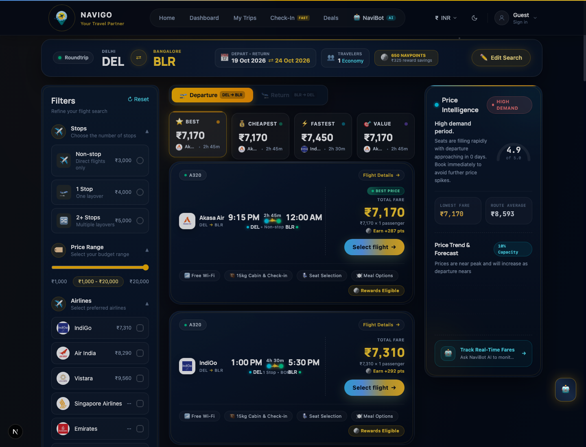
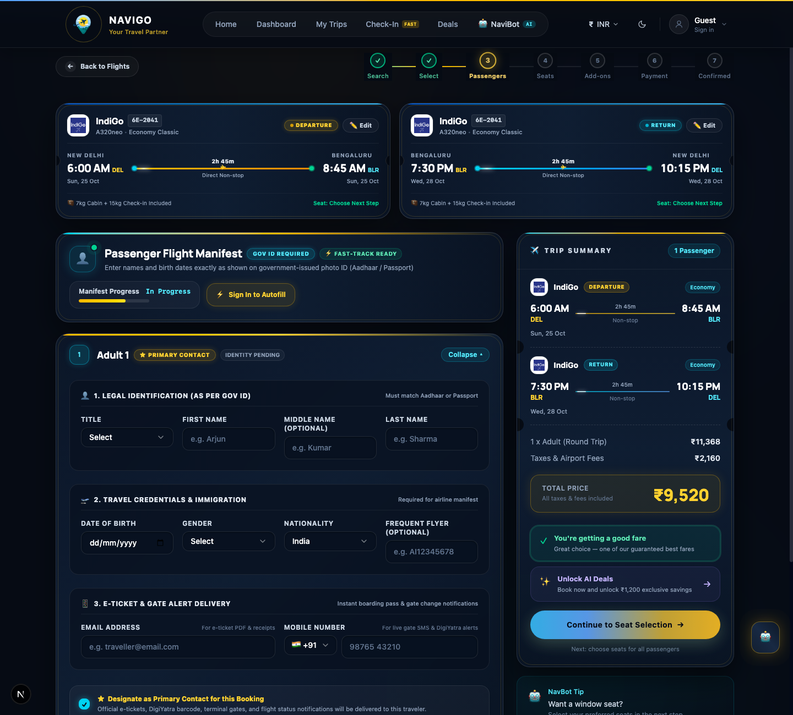
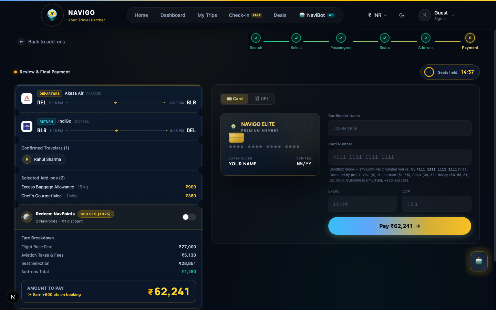
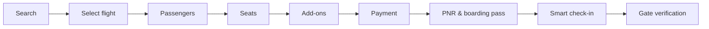
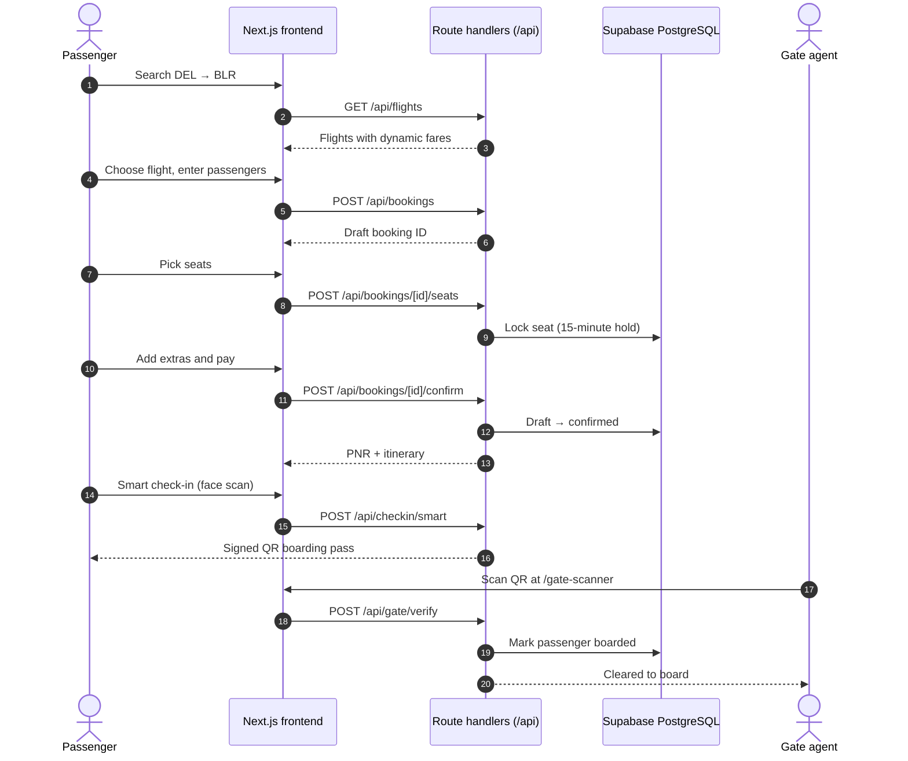
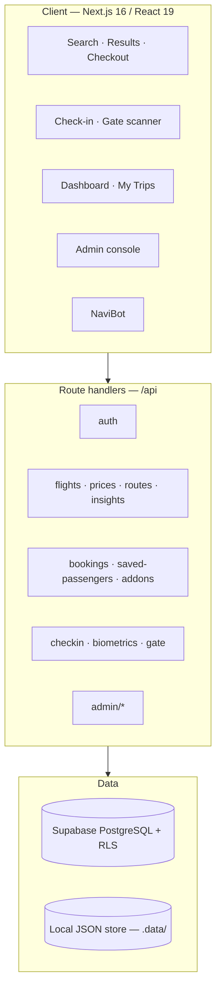

<div align="center">


# Navigo

**Full-stack airline booking and airport operations platform**

Flight search with dynamic pricing · interactive seat maps · add-ons and checkout · biometric check-in · gate verification · airline admin console

[](https://nextjs.org/)
[](https://react.dev/)
[](https://www.typescriptlang.org/)
[](https://tailwindcss.com/)
[](https://supabase.com/)

[Overview](#overview) · [Screenshots](#screenshots) · [Features](#features) · [Architecture](#architecture) · [Getting started](#getting-started) · [API](#api-reference) · [Security](#security)

</div>

---

## Overview

Navigo covers the full passenger journey of a commercial airline, from searching for a flight to clearing the boarding gate, together with the internal tools an airline uses to run its operations.

| Area | What it does |
| :--- | :--- |
| **Booking** | A six-step flow: search → select flight → passengers → seats → add-ons → payment, with round-trip and multi-leg support |
| **Pricing** | Fares adjust to booking window, route demand and seat availability; a 7-day fare calendar shows the cheapest dates |
| **Seating** | Cabin maps for Economy, Premium Economy, Business and First, with exit rows, seat holds and a 15-minute hold timer |
| **Check-in & boarding** | DigiYatra-style face enrolment, signed QR boarding passes, PDF e-tickets and a gate scanner that verifies passengers |
| **Loyalty** | NavPoints earned on every booking and redeemable at checkout (2 points = ₹1) |
| **Assistant** | NaviBot, an in-app assistant for flight and fare questions |
| **Operations** | Admin console for flights, pricing rules, seat inventory, gates, bookings, passengers, revenue and audit logs |

---

## Screenshots

<table>
  <tr>
    <td width="50%"><b>Home &amp; flight search</b><br/></td>
    <td width="50%"><b>Search results &amp; price intelligence</b><br/></td>
  </tr>
  <tr>
    <td><b>Passenger details</b><br/></td>
    <td><b>Seat selection</b><br/></td>
  </tr>
  <tr>
    <td><b>Add-ons</b><br/></td>
    <td><b>Payment</b><br/></td>
  </tr>
</table>

---

## Features

### Passenger experience
- **Flight search** – IATA airport autocomplete, round-trip / one-way / multi-city, passenger count and cabin class.
- **Results** – Filters for stops, price and airline; *Best / Cheapest / Fastest / Value* sorting; fare-trend and demand insights.
- **Passenger manifest** – Government-ID-aligned forms, primary-contact selection and a saved-traveller address book.
- **Seat map** – Four cabin tiers, per-leg seat assignment, exit-row and lavatory/galley markers, live seat locking.
- **Add-ons** – Extra baggage, meals, lounge access, travel protection and in-flight Wi-Fi with a live fare summary.
- **Payment** – Card (Luhn validation, brand detection), UPI QR and NavPoints redemption; runs in sandbox mode by default.
- **After booking** – PNR confirmation, boarding pass and PDF e-ticket, trip dashboard and *My Trips* history.

### Airport operations
- **Smart check-in** – PNR lookup and webcam face enrolment; only a hashed facial template is stored.
- **Gate scanner** (`/gate-scanner`) – Verifies the signed QR pass and booking status, then marks the passenger as boarded.

### Airline admin (`/admin`)
Flights and instances · pricing rules · seat inventory and overrides · gates · bookings · passengers · add-ons catalogue · smart check-in · revenue and analytics · alerts · audit logs · settings.

---

## Booking flow



<details>
<summary><b>Detailed request sequence</b></summary>



</details>

---

## Architecture



### Tech stack

| Layer | Technology |
| :--- | :--- |
| Framework | Next.js 16 (App Router, route handlers) |
| UI | React 19, TypeScript 5, Tailwind CSS 4, Radix UI, Lucide icons |
| Animation | Framer Motion |
| Data | Supabase (PostgreSQL with Row Level Security) |
| Auth | JWT sessions, bcrypt password hashing |
| Documents | jsPDF + html2canvas-pro (e-tickets), qrcode.react (boarding passes) |

### Project structure

```
navigo/
├── app/
│   ├── page.tsx              # Home and flight search
│   ├── flights/              # Search results
│   ├── checkout/             # passengers · seats · addons · payment
│   ├── check-in/             # PNR lookup and smart check-in
│   ├── gate/  gate-scanner/  # Gate display and boarding verification
│   ├── dashboard/  my-trips/ # Passenger account
│   ├── navibot/              # Full-page assistant
│   ├── admin/                # Airline operations console
│   └── api/                  # Route handlers
├── components/               # Navbar, search box, flight card, modals, NaviBot
├── lib/                      # pricing, seats, navpoints, biometrics, qr-security, supabase client
├── scripts/                  # Flight seeding and verification scripts
├── supabase/migrations/      # SQL migrations and RLS policies
└── public/                   # Logo, airline logos, seat images, screenshots
```

---

## Getting started

### Prerequisites
- Node.js 20 or 22
- npm
- A Supabase project (optional for local development — see note below)

### Installation

```bash
git clone https://github.com/Dhruv-vm/Navigo-airline_Platform.git
cd Navigo-airline_Platform
npm install
```

### Environment variables

Create `.env.local` in the project root:

```env
NEXT_PUBLIC_SUPABASE_URL=https://your-project.supabase.co
NEXT_PUBLIC_SUPABASE_ANON_KEY=your-anon-key
JWT_SECRET=a-long-random-string

# Optional — payments run in sandbox mode unless these are set
PAYMENT_GATEWAY_MODE=sandbox
RAZORPAY_KEY_SECRET=
STRIPE_SECRET_KEY=
```

> **Note:** For local development the app can also run against a file-backed store in `.data/navigo_db.json`, which is git-ignored.

### Database

Apply the SQL in `supabase/migrations/` using the Supabase dashboard or CLI, then seed flight data:

```bash
npm run seed:flights
```

### Run

```bash
npm run dev      # http://localhost:3000
npm run build    # production build
npm run start    # serve the production build
npm run lint
```

### Sandbox testing

Payments are simulated in sandbox mode. Any Luhn-valid card number works, for example:

| Brand | Number | Expiry | CVV |
| :--- | :--- | :--- | :--- |
| Visa | `4111 1111 1111 1111` | `12/29` | `123` |
| Mastercard | `5105 1051 0510 5100` | `10/28` | `456` |

Checkout pages accept a `?demo=1` query parameter (e.g. `/checkout/seats?demo=1`) to load sample booking data for testing a single step.

---

## API reference

<details>
<summary><b>Authentication</b></summary>

| Endpoint | Method | Description |
| :--- | :--- | :--- |
| `/api/auth/signup` | POST | Create an account |
| `/api/auth/login` | POST | Sign in and receive a JWT |
| `/api/auth/logout` | POST | End the session |
| `/api/auth/me` | GET | Current user |
| `/api/auth/forgot-password` · `/api/auth/reset-password` | POST | Password recovery |

</details>

<details>
<summary><b>Flights and pricing</b></summary>

| Endpoint | Method | Description |
| :--- | :--- | :--- |
| `/api/flights` | GET | Search flights with dynamic fares |
| `/api/flights/[instanceId]/seats` | GET | Seat availability for a flight |
| `/api/flights/gate` | GET | Gate assignments |
| `/api/prices` | GET | 7-day fare calendar for a route |
| `/api/routes` · `/api/insights` | GET | Popular routes and price insights |
| `/api/navibot` | POST | NaviBot assistant replies |

</details>

<details>
<summary><b>Bookings</b></summary>

| Endpoint | Method | Description |
| :--- | :--- | :--- |
| `/api/bookings` | GET, POST | List bookings / create a draft booking |
| `/api/bookings/[bookingId]/passengers` | GET | Passengers on a booking |
| `/api/bookings/[bookingId]/seats` | GET, POST, DELETE | View, hold or release seats |
| `/api/bookings/[bookingId]/confirm` | POST | Confirm payment and issue a PNR |
| `/api/saved-passengers` | GET | Saved traveller profiles |
| `/api/addons` | GET | Add-on catalogue |

</details>

<details>
<summary><b>Check-in, biometrics and gate</b></summary>

| Endpoint | Method | Description |
| :--- | :--- | :--- |
| `/api/checkin/verify-pnr` | POST | Verify a PNR for check-in |
| `/api/checkin/smart` | POST | Complete check-in and issue a boarding pass |
| `/api/biometrics/profile` | GET, POST, DELETE | Enrol, verify or remove a face profile |
| `/api/gate/verify` | POST | Validate a boarding-pass QR at the gate |

</details>

<details>
<summary><b>Admin</b></summary>

| Endpoint | Description |
| :--- | :--- |
| `/api/admin/stats` | Revenue, occupancy and passenger metrics |
| `/api/admin/flights` · `/api/admin/instances` | Manage routes and scheduled flights |
| `/api/admin/seats` | Seat overrides (hold, block, release) |
| `/api/admin/bookings` · `/api/admin/passengers` | Bookings and passenger records |
| `/api/admin/audit-logs` | Operational audit trail |

All admin endpoints require an administrator session.

</details>

---

## Security

- **Sanitised errors** – database errors, stack traces and internal IDs are not returned to the client.
- **PNR protection** – looking up a booking you don't own requires the passenger's last name, preventing enumeration.
- **Biometric privacy** – only hashed facial templates are stored, never raw images.
- **Signed boarding passes** – QR payloads are signed and checked at the gate to prevent forgery and replay.
- **Protected endpoints** – catalogue writes and all `/api/admin/*` routes require admin privileges; Supabase tables use Row Level Security.

---

## License

No license has been specified yet. All rights reserved by the author unless a license file is added.

<div align="center">
<sub>Built by <a href="https://github.com/Dhruv-vm">Dhruv</a></sub>
</div>
