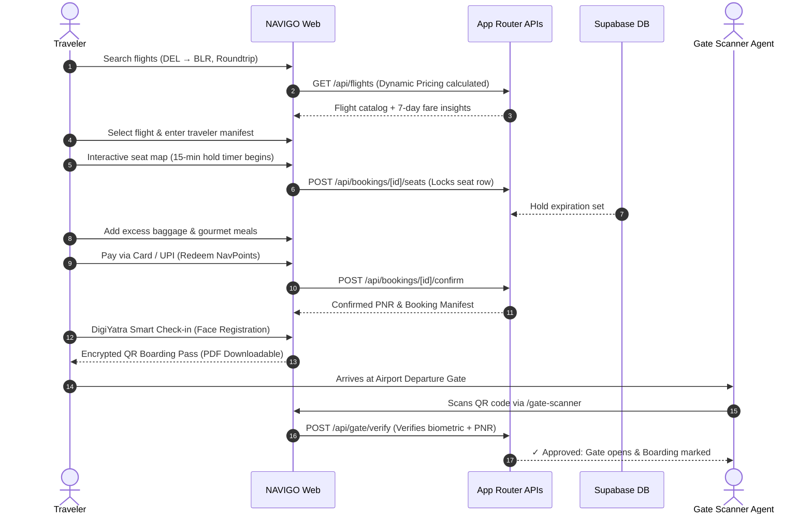

# NAVIGO ✈️
### *Next-Generation Airline Booking, Smart Airport Operations & Biometric Travel Platform*

<div align="center">

[](https://nextjs.org/)
[](https://react.dev/)
[](https://www.typescriptlang.org/)
[](https://tailwindcss.com/)
[](https://supabase.com/)
[](https://www.framer.com/motion/)

<p align="center">
  <b>A luxury aerospace digital experience blending high-converting passenger booking flows, cinematic 3D seat selection, DigiYatra-style facial biometrics, and enterprise airline operational dispatching.</b>
</p>

[Explore Key Features](#-key-features) •
[Interactive Architecture](#-system-architecture) •
[Booking & Airport Workflow](#-booking--airport-workflow) •
[Quickstart Guide](#-getting-started) •
[API Reference](#-api-endpoints) •
[Design System](#-design-system--typography)

---

</div>

## 🌟 Executive Summary

**NAVIGO** is a modern full-stack airline reservation and airport operations suite. Engineered for high performance, visual immersion, and production-grade security, NAVIGO bridges the gap between commercial consumer airline booking and real-world ground operations:

- **End-to-End Traveler Journey**: Seamless 6-step booking funnel from dynamic flight search and multi-cabin seat selection to personalized add-ons and automated boarding pass generation.
- **Smart Airport & Biometrics**: Contactless DigiYatra-style airport processing featuring facial biometric enrollment, live gate QR code scanners, and instant passenger verification.
- **Dynamic Pricing & Yield Management**: Real-time pricing engine factoring in advance booking windows, seat occupancy curves, and route demand surges.
- **Mission Control Admin Suite**: Complete dispatch dashboard for airline staff to oversee live flight telemetry, cabin seat inventory overrides, pricing rules, and gate assignments.

---

## 🚀 Key Features

### 💺 1. Cinematic 3D Fuselage Seat Map & Mechanical Odometer
- **Interactive Aircraft Cabin**: Select seats across **First Class (Private Pods)**, **Business Class (Flatbeds)**, **Premium Economy**, and **Standard Economy**.
- **Avionics Visuals**: Emergency exit doors, aircraft wings, and single/twin aisle layouts rendered with sub-millisecond responsiveness.
- **Multi-Leg Manifest**: Departure and Return seats preserved in a unified reservation manifest with intelligent 2-second confirmation auto-switch.
- **Spring-Physics Rolling Counter**: Mechanical rolling digit counter (`RollingPriceCounter`) powered by Framer Motion springs and formatted in real Indian Rupee currency (`₹XX,XXX`).
- **Real-Time Seat Locks**: 15-minute countdown hold timer preventing double-booking during checkout.

### 🛂 2. DigiYatra-Style Smart Check-in & Biometrics
- **Contactless Airport Journey**: Instant PNR retrieval with webcam/file facial biometric enrollment.
- **Cryptographic Gate Passes**: Dynamic boarding passes embedded with tamper-evident digital QR codes.
- **Live Gate Scanner (`/gate-scanner`)**: Turnkey interface for airport ground agents to scan boarding passes, run biometric facial matching, and update gate boarding manifests live.
- **Client-Side PDF Generation**: One-click boarding pass download rendered with `jspdf` and `html2canvas-pro`.

### 🛒 3. Add-ons & In-Flight Services Marketplace
- **Curated Comfort Upgrades**: Pre-book excess baggage allowance (10kg / 15kg / 20kg), chef-crafted hot meals, and executive airport lounge passes at up to 20% savings.
- **Travel Protection & Connectivity**: Integrated international flight insurance and high-speed satellite Wi-Fi flight passes.
- **Unified Boarding Pass Architecture**: Livery-styled itinerary ticket stubs with interactive flight edit triggers and smooth variant switchers.

### 💳 4. Sandboxed Payment & NavPoints Loyalty Engine
- **Interactive 3D Flipping Card**: Real-time visual payment card that detects brand (Visa, Mastercard, American Express, RuPay) and flips dynamically when entering the CVV.
- **Luhn Algorithm Validation**: Full client-side card sanitization and Luhn checksum verification with instant error hints.
- **NavPoints Rewards**: Loyalty currency engine where **2 NavPoints = ₹1 discount**. Travelers can redeem points via an interactive slider or instant quick-pick chips.
- **UPI Gateway Simulation**: Interactive QR code and VPA handle verification for frictionless payments.

### 🤖 5. NaviBot AI Flight Concierge
- **Autonomous Flight Assistant**: Floating AI concierge available on every page to answer baggage policies, terminal gate directions, check-in deadlines, and route options.
- **Personalized Recommendations**: Context-aware flight advice tailored to the traveler's active itinerary.

### 🏢 6. Enterprise Airline Operations Admin (`/admin`)
- **Fleet & Instance Dispatcher**: Manage aircraft routes, schedules, turnaround delays, and status (On-Time, Delayed, Boarding, Departed).
- **Dynamic Pricing Rulebook**: Configure base fares, peak-hour multipliers, and demand surge thresholds per route.
- **Cabin Seat Inventory Overrides**: Manually block seats for VIPs, release locked seats, or reassign passengers.
- **Tamper-Evident Audit Logging**: Complete operational trail capturing passenger bookings, seat modifications, gate check-ins, and refunds.

---

## 📐 System Architecture

```mermaid
flowchart TD
    subgraph Client ["Client Layer (Next.js 16 + React 19)"]
        Landing["Landing & Flight Search\n(/, /flights)"]
        BookingFlow["6-Step Checkout Flow\n(/checkout/*)"]
        SmartCheckIn["DigiYatra Check-In & Gate\n(/check-in, /gate-scanner)"]
        Dashboard["Passenger Dashboard\n(/dashboard, /my-trips)"]
        AdminSuite["Airline Mission Control\n(/admin/*)"]
        NaviBot["NaviBot AI Concierge\n(Floating Widget)"]
    end

    subgraph StateEngine ["State & Animation Engines"]
        Framer["Framer Motion\n(Spring Physics & Odometers)"]
        Loyalty["NavPoints Engine\n(2 pts = ₹1 discount)"]
        PDF["PDF Deck & Canvas\n(jspdf + html2canvas)"]
    end

    subgraph Backend ["Next.js App Router API (/api/*)"]
        AuthAPI["/api/auth/*\n(JWT + BCrypt)"]
        FlightsAPI["/api/flights/*\n(Search, Instances, Pricing)"]
        BookingsAPI["/api/bookings/*\n(Seats, Hold Timers, Confirm)"]
        BiometricsAPI["/api/biometrics/*\n(DigiYatra Face Profiles)"]
        GateAPI["/api/gate/verify\n(Boarding QR Verification)"]
        AdminAPI["/api/admin/*\n(Stats, Logs, Overrides)"]
    end

    subgraph Database ["Supabase PostgreSQL (RLS Hardened)"]
        Users[("users")]
        Flights[("flights & flight_instances")]
        Bookings[("bookings & passengers")]
        Seats[("seats (locks & status)")]
        BiometricData[("biometrics & qr_passes")]
        AuditLogs[("audit_logs")]
    end

    Client --> StateEngine
    StateEngine --> Backend
    Backend --> Database
```



---

## ✈️ Booking & Airport Workflow



---

## 📂 Project Structure

```
navigo/
├── app/
│   ├── page.tsx                      # Luxury landing page & interactive search box
│   ├── layout.tsx                    # Root layout with font optimization & NaviBot
│   ├── globals.css                   # Tailwind CSS v4 design system & custom utilities
│   ├── flights/page.tsx              # Flight search results, filters & fare insights
│   ├── checkout/
│   │   ├── passengers/page.tsx       # Traveler manifest details & saved traveler book
│   │   ├── seats/page.tsx            # 3D aircraft fuselage seat map & rolling counter
│   │   ├── addons/page.tsx           # Baggage, meals & lounge luxury upgrades
│   │   └── payment/
│   │       ├── page.tsx              # Sandboxed 3D card, UPI & NavPoints redemption
│   │       ├── PaymentCard.tsx       # Interactive flipping 3D credit card component
│   │       ├── BoardingPassDeck.tsx  # Boarding pass deck & ticket stubs
│   │       └── cardUtils.ts          # Luhn checksum algorithm & card brand detector
│   ├── check-in/page.tsx             # PNR search & DigiYatra smart check-in
│   ├── gate/page.tsx                 # Airport terminal gate view
│   ├── gate-scanner/page.tsx         # Live camera/input gate boarding pass scanner
│   ├── dashboard/page.tsx            # Passenger flight telemetry, countdown & trips
│   ├── my-trips/page.tsx             # Booking history & PDF boarding pass downloads
│   ├── navibot/page.tsx              # Full-screen NaviBot AI concierge chat
│   ├── admin/
│   │   ├── page.tsx                  # Airline executive overview & revenue analytics
│   │   ├── flights/                  # Route & flight instance scheduling
│   │   ├── pricing/                  # Dynamic pricing rules & occupancy thresholds
│   │   ├── seats/                    # Real-time cabin seat inventory controller
│   │   ├── gates/                    # Terminal gate manager & status broadcaster
│   │   ├── bookings/                 # Live booking manifests & cancellations
│   │   ├── passengers/               # Passenger records & biometric IDs
│   │   └── audit-logs/               # Tamper-evident operational audit trail
│   └── api/                          # Next.js App Router serverless endpoints
├── components/
│   ├── navbar.tsx                    # Global glassmorphism navigation header
│   ├── searchbox.tsx                 # Real-time flight search & airport autocomplete
│   ├── rolling-price-counter.tsx     # Spring-physics rolling digit odometer
│   ├── FlightCard.tsx                # Serene boarding pass flight result card
│   ├── PriceInsight.tsx              # 7-day lowest fare trajectory calendar
│   ├── NaviBot.tsx                   # Floating conversational flight AI widget
│   └── FaceRegistrationModal.tsx     # Webcam biometric facial enrollment modal
├── lib/
│   ├── pricing.ts                    # Dynamic pricing & occupancy yield algorithms
│   ├── navpoints.ts                  # NavPoints loyalty points ledger & calculation
│   ├── biometrics.ts                 # Biometric identity & DigiYatra simulator
│   ├── qr-security.ts                # Cryptographic QR signing & validation
│   ├── supabase.ts                   # Supabase PostgreSQL client
│   └── airports.ts                   # Major airport catalog & IATA route mappings
├── scripts/
│   ├── populate-flights.ts           # Automatic flight instance seeder
│   └── pre-production-verification.ts# Pre-deploy data integrity test suite
└── supabase/
    └── migrations/                   # PostgreSQL DDL & Row Level Security (RLS)
```

---

## 🛠️ Technology Stack

| Domain | Technology | Purpose |
| :--- | :--- | :--- |
| **Framework** | [Next.js 16.2.6](https://nextjs.org/) | React 19 Server Components, App Router, Route Handlers |
| **Language** | [TypeScript 5](https://www.typescriptlang.org/) | End-to-end type safety, strict interface contracts |
| **Styling** | [Tailwind CSS v4](https://tailwindcss.com/) | PostCSS pipeline, luxury dark aerospace design system |
| **Animations** | [Framer Motion 13](https://www.framer.com/motion/) | Spring-based rolling digits, 3D card flip, smooth drawer states |
| **Database & Auth** | [Supabase](https://supabase.com/) | PostgreSQL database, Row Level Security (RLS) policies, JWT |
| **Icons & UI** | [Lucide React](https://lucide.dev/) + [Radix UI](https://www.radix-ui.com/) | Accessible primitives & vector flight glyphs |
| **Document Export** | `jspdf` + `html2canvas-pro` | High-fidelity digital PDF boarding pass generation |
| **QR Engine** | `qrcode.react` | Cryptographic boarding pass verification QR codes |

---

## ⚡ Getting Started

### 1. Prerequisites
- **Node.js**: `v20.x` or `v22.x` (LTS recommended)
- **Package Manager**: `npm`, `pnpm`, or `bun`
- **Supabase Project**: Free or paid Supabase PostgreSQL instance

### 2. Clone & Install Dependencies
```bash
git clone https://github.com/your-username/navigo.git
cd navigo
npm install
```

### 3. Environment Configuration
Create a `.env.local` file in the root directory:

```env
# Supabase Configuration
NEXT_PUBLIC_SUPABASE_URL=https://your-project.supabase.co
NEXT_PUBLIC_SUPABASE_ANON_KEY=eyJhbGciOiJIUzI1NiIsInR5cCI6IkpXVCJ9...

# Authentication Secret
JWT_SECRET=your_super_secret_jwt_key_here

# Payment Gateway Simulation Mode (sandbox / live)
PAYMENT_GATEWAY_MODE=sandbox
```

### 4. Database Setup & Seeding
Apply the RLS production hardening migration located in `supabase/migrations/20261015_rls_hardening.sql` using the Supabase SQL editor or CLI.

Then seed flight instances, cabin layouts, and initial routes:
```bash
npm run seed:flights
```

### 5. Launch Development Server
```bash
npm run dev
```

Open [http://localhost:3000](http://localhost:3000) in your browser.

---

## 🧪 Demo Modes & Sandbox Testing

For rapid testing, stakeholder demonstrations, and QA audits, NAVIGO includes built-in demo routes with mock pre-loaded reservations:

| Route | URL with Demo Query | What You Can Test |
| :--- | :--- | :--- |
| **Seat Map** | `/checkout/seats?demo=1` | Test cabin switching (I → IV), multi-leg selections, exit rows, and rolling price counters. |
| **Add-ons Marketplace** | `/checkout/addons?demo=1` | Test luggage variant pickers, meal selections, and real-time total recalculations. |
| **Payment Gateway** | `/checkout/payment?demo=1` | Test the 3D flipping card, NavPoints discount slider, and instant boarding pass generation. |
| **Airport Gate Scanner** | `/gate-scanner` | Test passenger barcode/QR scan verification and biometric identity clearance. |
| **Airline Admin Console** | `/admin` | Inspect flight instance telemetry, pricing matrices, and live audit logs. |

### Sandbox Test Cards (Luhn Validated)
| Card Brand | Card Number | Expiry | CVV |
| :--- | :--- | :--- | :--- |
| **Visa** | `4111 1111 1111 1111` | `12/29` | `123` |
| **Mastercard** | `5105 1051 0510 5100` | `10/28` | `456` |
| **American Express** | `3782 8224 6310 005` | `08/27` | `1234` |
| **RuPay** | `6061 2345 6789 0123` | `11/30` | `789` |

---

## 📡 API Endpoints

### 🛫 Flight & Route Operations
| Endpoint | Method | Description |
| :--- | :--- | :--- |
| `/api/flights` | `GET` | Search active flights with dynamic pricing and filters |
| `/api/flights/[instanceId]/seats` | `GET` | Fetch real-time cabin seat occupancy map |
| `/api/flights/gate` | `GET` | Retrieve live departure gate assignments |
| `/api/prices` | `GET` | 7-day price insight matrix for a given route |

### 🎟️ Booking & Checkout
| Endpoint | Method | Description |
| :--- | :--- | :--- |
| `/api/bookings` | `POST` | Create a draft booking session |
| `/api/bookings/[id]/seats` | `POST`, `DELETE` | Hold/lock seats or release expired holds |
| `/api/bookings/[id]/passengers` | `POST` | Save passenger manifest records |
| `/api/bookings/[id]/confirm` | `POST` | Settle payment and issue confirmed PNR |

### 🛂 Smart Airport & Biometrics
| Endpoint | Method | Description |
| :--- | :--- | :--- |
| `/api/checkin/verify-pnr` | `POST` | Look up itinerary and eligibility for check-in |
| `/api/checkin/smart` | `POST` | Complete smart check-in and issue digital boarding pass |
| `/api/biometrics/profile` | `POST`, `GET` | Register or verify DigiYatra facial signature |
| `/api/gate/verify` | `POST` | Gate scanner API to validate boarding pass QR codes |

### 🛡️ Airline Administration
| Endpoint | Method | Description |
| :--- | :--- | :--- |
| `/api/admin/stats` | `GET` | High-level passenger volume, revenue, and occupancy metrics |
| `/api/admin/instances` | `GET`, `POST` | Schedule, delay, or update flight instances |
| `/api/admin/seats` | `POST` | Override seat statuses (VIP hold, maintenance, unblock) |
| `/api/admin/audit-logs` | `GET` | Fetch system-wide security and operational events |

---

## 🎨 Design System & Typography

NAVIGO features a bespoke **Dark Aerospace Luxury** visual language inspired by modern commercial aviation cockpits and premier airline first-class cabins:

```
Deep Sky Night        [#060B14]  ████████  Background canvas & cockpit horizon
Cockpit Surface       [#0D1A2C]  ████████  Glassmorphic card panels & ticket stubs
Gold Leaf Metallic    [#D4AF37]  ████████  Primary branding, First Class & active accents
Amber Glow            [#FBBF24]  ████████  Call-to-action buttons & odometer numbers
Avionics Cyan         [#38BDF8]  ████████  Flight vectors, telemetry radar & Return tags
Runway Emerald        [#34D399]  ████████  Checkmarks, discount badges & confirmed seats
Alert Rose            [#FB7185]  ████████  Seat hold countdown urgency & gate warnings
```

### Typography Hierarchy
- **Brand & Headings**: `Manrope` (`font-display`) — Ultra-clean geometric sans-serif engineered for modern digital clarity.
- **Flight Deck Telemetry**: `JetBrains Mono` (`font-board`) — High-precision monospace font used for IATA codes, flight numbers, PNRs, and seat labels.
- **Micro-Copy**: Natural sentence casing with spacious, un-cramped tracking. Monospace uppercase is reserved exclusively for authentic airline ticket stubs and boarding pass barcodes.

---

## 🔒 Security & Data Privacy

- **Row Level Security (RLS)**: PostgreSQL tables are enforced at the engine level with idempotent policies. Anonymous public keys cannot query private passenger data or booking histories.
- **Biometric Encryption**: Facial verification templates are salted, hashed, and never stored as raw uncompressed biometric images.
- **Cryptographic Boarding Passes**: Digital QR codes contain HMAC signatures to prevent counterfeit pass generation at boarding gates.
- **Audit Logs**: All booking creations, payment settlements, and seat overrides are immutably logged for FAA/DGCA style compliance auditing.

---

## 🤝 Contributing

Contributions to NAVIGO are welcome! To contribute:
1. Fork the Project
2. Create your Feature Branch (`git checkout -b feature/AmazingFeature`)
3. Commit your Changes (`git commit -m 'Add some AmazingFeature'`)
4. Push to the Branch (`git push origin feature/AmazingFeature`)
5. Open a Pull Request

---

## 📄 License

Distributed under the **MIT License**. See `LICENSE` for more information.

<div align="center">
  <sub>Engineered with precision for the future of aviation. © NAVIGO Airlines & Smart Airport Technologies.</sub>
</div>
